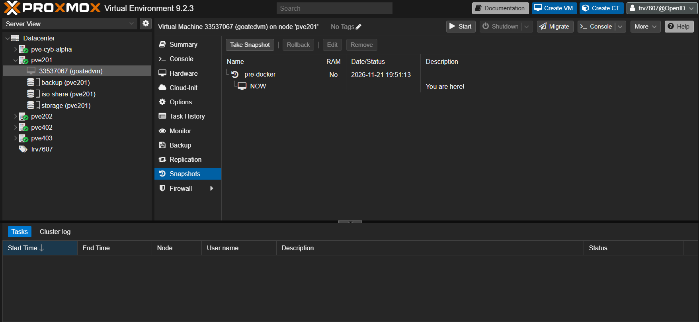
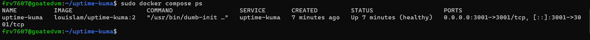
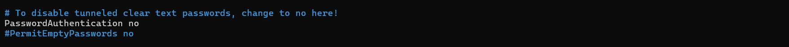
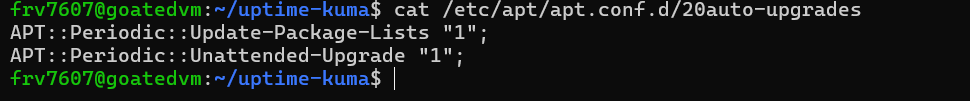
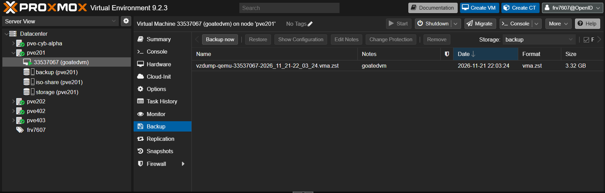
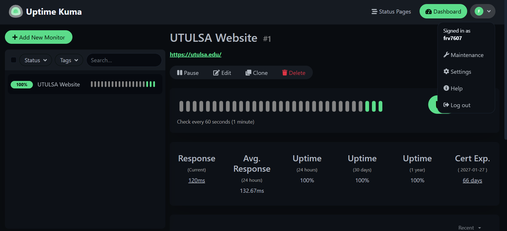
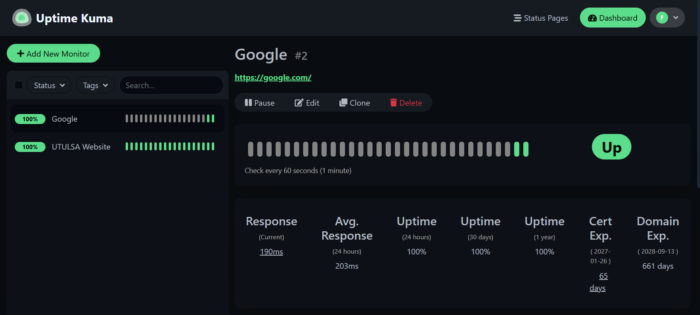
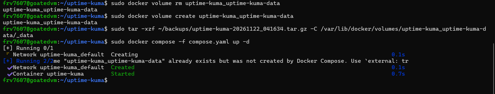
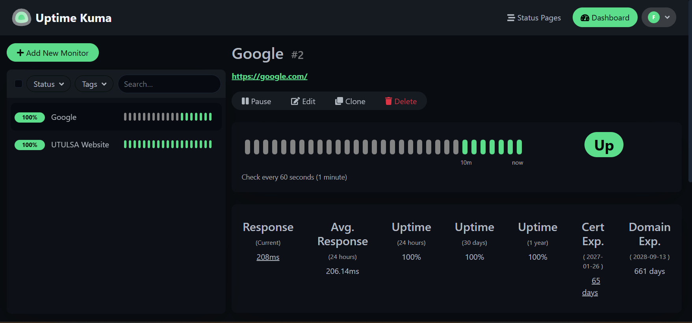

# Docker Compose Lab (Deploying and securing Uptime Kuma)

 This guide goes over the main steps of deploying Uptime Kuma on a Ubuntu VM in Proxmox using Docker Compose, securing the VM, setting up backups and lastly running a recovery restore drill.

## Step 1: *Take a Baseline Snapshot in Proxmox*

Before installing Docker, I opened Proxmox, went to **Snapshots**, created a snapshot, and named it pre-docker. That way, if anything went wrong during setup, there would be a snapshot to fallback to.



---

## Step 1.5: *Connect to the VM Through Your Own System*

After taking the snapshot, to make things easier for myself I chose to connect to the VM through ssh:

```shell
ssh your_vm_user@your_vm_ip
```
— Opens up an SSH session to your VM

## Step 2: *Installing Docker*

### A. Fix the CD-ROM Source and Add Docker's GPG Key

When trying to download docker I kept on getting a cdrom error. The reason is because `apt` initially tried to read from the local cdrom: source. So to fix that I commented out that first line in `/etc/apt/sources.list`. After fixing that I installed `ca-certificates` and `curl`, and downloaded Docker's official GPG key.

```shell
sudo sed -i '1s/^/#/' /etc/apt/sources.list
```
— Comments out the first line of the package source list so apt doesn't throw an error looking for the original installation CD

```shell
sudo apt update && sudo apt install -y ca-certificates curl
```
— Refreshes the system's package list and installs curl and ca-certificates

```shell
sudo install -m 0755 -d /etc/apt/keyrings
```
— Creates a dedicated folder to store trusted repository security keys.

```shell
sudo curl -fsSL https://download.docker.com/linux/ubuntu/gpg -o /etc/apt/keyrings/docker.asc
```
— Downloads Docker's official GPG key into that folder so Ubuntu can verify that the Docker packages are authentic.

### B. Add the Docker Repository and Install Docker Engine

Next, I added Docker's official Ubuntu repository to sources.list.d and installed docker-ce along with the docker-compose-plugin.

```shell
echo "deb [arch=$(dpkg --print-architecture) signed-by=/etc/apt/keyrings/docker.asc] \
https://download.docker.com/linux/ubuntu $(. /etc/os-release && echo $VERSION_CODENAME) stable" \
| sudo tee /etc/apt/sources.list.d/docker.list 
```
— Adds Docker's official Ubuntu repository to APT's package sources

```shell
sudo apt update && sudo apt install -y docker-ce docker-ce-cli containerd.io docker-buildx-plugin docker-compose-plugin
```
— Updates package indexes and installs Docker Engine, CLI, containerd, and the Docker Compose plugin

### C. Enable Docker on Boot and Verify Installation

To make sure Docker starts automatically after a reboot, I enabled the Docker service and ran hello-world to check that everything worked

```shell
sudo systemctl enable --now docker
```

— Enables the Docker service to start automatically on boot and starts it immediately

```shell
systemctl is-enabled docker
```
— Checks if docker will start at boot

```shell
sudo docker run --rm hello-world
```
— Runs and removes a temporary test container to verify Docker Engine works properly

```shell
docker compose version
```
— Prints the installed Docker Compose version, confirming the Compose plugin installed correctly
## Step 3: *Deploy Uptime Kuma with Docker Compose*

### A. Create the Project Directory and compose.yaml
I created a dedicated uptime-kuma directory, went into it, and created and wrote a compose.yaml file using:

```shell
mkdir uptime-kuma
```
— Creates a directory named uptime-kuma

```shell
cd uptime-kuma
```
— Changes directory to uptime-kuma

```shell
nano compose.yaml
```
— Creates the file and lets you go into the file to set up configurations

### Configuration: `~/uptime-kuma/compose.yaml`

```yaml
services:
  uptime-kuma:
    image: louislam/uptime-kuma:2
    container_name: uptime-kuma
    volumes:
      - uptime-kuma-data:/app/data
    ports:
      - "3001:3001"
    restart: unless-stopped

volumes:
  uptime-kuma-data:
```

### B. Start the Container and Verify That It Survives a Reboot
With compose.yaml in place, I launched Uptime Kuma, checked its status with docker compose ps, and ran sudo reboot to confirm the container automatically came back online.

```shell
sudo docker compose up -d
```
— Pulls the louislam/uptime-kuma:2 image and launches the container in the background

```shell
sudo docker compose ps
```

— Lists active Compose containers to verify Uptime Kuma is running:



Navigate to your webpage to see if its working:
```shell
http://your_vm_ip:3001
```


```shell
sudo reboot
```
— Restarts the VM 


Once the VM booted back up, the website came back up, and I added my first monitor for the utulsa.edu website.

## Step 4: *Securing the VM* 
### A. Set Up SSH Key Authentication and Disable Password Logins

To ensure I wouldn't get locked out after disabling passwords, I first generated an SSH key pair on my local git bash , copied the public key to the VM's `~/.ssh/authorized_keys` file, and verified that key-based login worked in a second terminal window.

```shell
ssh-keygen -t ed25519
```
— Creates a new key pair using ed25519

```shell
ssh-copy-id your-user-id@your-vm's-ip
```
— Copies the client's public SSH key into ~/.ssh/authorized_keys on the VM with the proper permissions

```shell
ssh your-user-id@your-vm's-ip
```

— Tests logging into the VM using the SSH key in a separate terminal session before disabling password authentication.

 After I checked the key-based login was working, I edited /etc/ssh/sshd_config to disable password authentication and reloaded the SSH service:

```shell
sudo nano /etc/ssh/sshd_config
```

— Opens the SSH server configuration file to set PasswordAuthentication no



```shell
sudo systemctl reload ssh
```

— Reloads the SSH daemon to apply key-only authentication without dropping active connections

### B. Test with the public-key authentication disabled:

```shell
ssh -o PubkeyAuthentication=no your-user-id@your-vm's-ip
```
— Attempts an SSH login without keys to verify that password authentication is refused

### Output:

```shell
Permission denied (publickey)
```

### C. Setup UFW (Firewall) 

I allowed SSH (22/tcp) and Uptime Kuma (3001/tcp) and enabled the firewall. Then I checked its status to see if my changes were made.

```shell
sudo ufw allow 22/tcp && sudo ufw allow 3001/tcp && sudo ufw enable
```
— Allows inbound SSH (22/tcp) and Uptime Kuma (3001/tcp) traffic and activates the firewall

```shell
sudo ufw status
```
— Prints the active firewall rules confirming only ports 22 and 3001 are open

### Output:

```shell
To                         Action      From
--                         ------      ----
22/tcp                     ALLOW       Anywhere
3001/tcp                   ALLOW       Anywhere
22/tcp (v6)                ALLOW       Anywhere (v6)
3001/tcp (v6)              ALLOW       Anywhere (v6)
```

### D. Enable Automatic Security Updates
Finally, I installed and enabled unattended-upgrades so the server automatically installs security updates.

```shell
sudo apt install -y unattended-upgrades && sudo dpkg-reconfigure -plow unattended-upgrades
```
— Installs the unattended-upgrades package and enables automatic daily security updates


## Step 5: *Set Up Volume Backups and Proxmox VM Backup*

### A. Create and Run the backup.sh Script

To have backups in case the volume gets deleted, the backup.sh will be created for that reason. The script stops the container, compresses the volume data directory into a timestamped .tar.gz archive in ~/backups, restarts the container, and deletes everything except the 7 newest archives.

### Creating the backup.sh Script:

```shell
nano backup.sh
```
— Creates the backup.sh file and lets you write in it

### backup.sh Script:
```shell
#!/bin/bash
set -e

mkdir -p "$HOME/backups";
TIMESTAMP=$(date +"%Y%m%d_%H%M%S")
VOLUME_PATH="/var/lib/docker/volumes/uptime-kuma_uptime-kuma-data/_data"
sudo docker compose -f "$HOME/uptime-kuma/compose.yaml" down
sudo tar -czf "$HOME/backups/uptime-kuma-${TIMESTAMP}.tar.gz" -C "$VOLUME_PATH" .
sudo docker compose -f "$HOME/uptime-kuma/compose.yaml" up -d
ls -1t "$HOME/backups"/uptime-kuma-*.tar.gz | tail -n +8 | xargs -r rm -f
```
—The script stops the container, compresses the volume data directory into a timestamped .tar.gz archive in ~/backups, restarts the container, and deletes everything except the 7 newest archives

Then I made the script executable, ran it multiple times, and checked ~/backups to verify multiple archives were created:

```shell
chmod +x backup.sh
```
— Grants execute permissions to backup.sh

```shell
./backup.sh
```
— Runs the backup script to create a timestamped .tar.gz archive of the Uptime Kuma volume

```shell
ls -lh ~/backups
```
— Lists the contents of ~/backups with human-readable sizes to verify multiple archives exist

Output:
```shell
total 116K
-rw-r--r-- 1 root root 36K Nov 22 03:58 uptime-kuma-20261122_035831.tar.gz
-rw-r--r-- 1 root root 36K Nov 22 03:58 uptime-kuma-20261122_035849.tar.gz
-rw-r--r-- 1 root root 42K Nov 22 04:16 uptime-kuma-20261122_041634.tar.gz
```
### B. VM Backup in Proxmox

Additionally, I opened the Backup tab for the VM in Proxmox and ran Backup now to create a full VM backup:



## Step 6: *Disaster Recovery Restore Drill*
### A. Add a New Website to Monitor, Back It Up and Delete the Volume

To make sure that the backup actually works, I first added a new monitor for google.com:

Before deleting the volume:



Added Google to monitor:




Next, to test with the recovery restore drill, I ran the backup.sh script, ran docker compose down and deleted the volume:

```shell
./backup.sh
```
—  Runs the backup script to save a backup 

```shell
sudo docker compose -f ~/uptime-kuma/compose.yaml down
```
— Stops and removes the running Uptime Kuma container

```shell
sudo docker volume rm uptime-kuma_uptime-kuma-data
```
— Permanently deletes the named Docker volume 
### B. Restore from the Backup Archive and Verify

To recover the data, I recreated an empty Docker volume with the same name, extracted the archived backup into its data directory, and started the container back up:

```shell
sudo docker volume create uptime-kuma_uptime-kuma-data
```
— Recreates an empty Docker volume with the exact name expected by compose.yaml

```shell
sudo tar -xzf ~/backups/uptime-kuma-20261122_041634.tar.gz -C /var/lib/docker/volumes/uptime-kuma_uptime-kuma-data/_data
```
— Extracts the newest valid backup archive into the recreated volume's data directory

```shell
sudo docker compose -f ~/uptime-kuma/compose.yaml up -d
```
— Starts Uptime Kuma back up using the restored volume data

After refreshing the webpage it was completely restored:

Deleting Volumes and using the backup to bring it back:


After picture of Uptime Kuma:

### *Sources*

#### Docker Volumes
* [Docker Volumes Documentation (Official Docker Docs)](https://docs.docker.com/engine/storage/volumes/) — Information over how to set up persistent data storage, inspecting `/var/lib/docker/volumes/`, and volume backup/restore procedures.

#### Uptime Kuma Deployment
* [Uptime Kuma Installation Wiki (Official GitHub)](https://github.com/louislam/uptime-kuma/wiki/%F0%9F%94%A7-How-to-Install) — Used for deploying the `louislam/uptime-kuma:2` container image and mapping port `3001:3001`.
* [Uptime Kuma Official `compose.yaml` Example (GitHub)](https://github.com/louislam/uptime-kuma/blob/master/compose.yaml) — Reference template for structuring the Docker Compose service and named volume.

#### Linux VM Hardening (SSH, UFW and Automatic Updates)
* [OpenSSH `ssh-keygen` Manual](https://man.openbsd.org/ssh-keygen) — Information over key pairs and how to set them up.
* [Ubuntu Server Guide: Uncomplicated Firewall (UFW)](https://ubuntu.com/server/docs/firewalls) — Information on configuring `ufw`.
* [Ubuntu Server Guide: Automatic Updates (`unattended-upgrades`)](https://ubuntu.com/server/docs/how-to/software/automatic-updates/) — Used for installing and configuring `unattended-upgrades` to apply daily security patches.
* [APT `sources.list` Manual (`cdrom:` repository fix)](https://manpages.ubuntu.com/manpages/noble/man5/sources.list.5.html) — Helped with the cdrom problem when trying to install docker.

